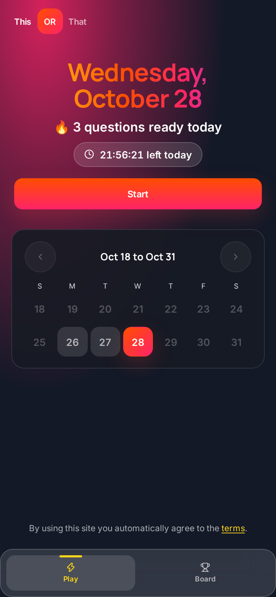
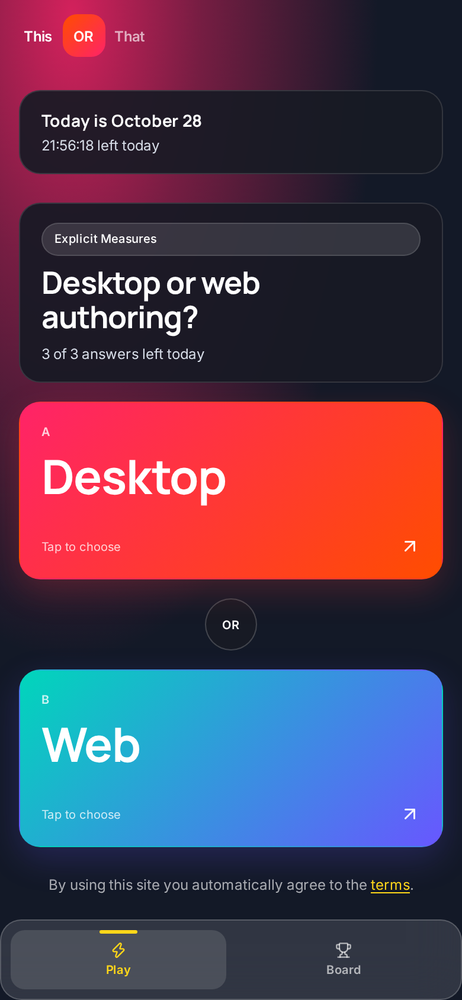
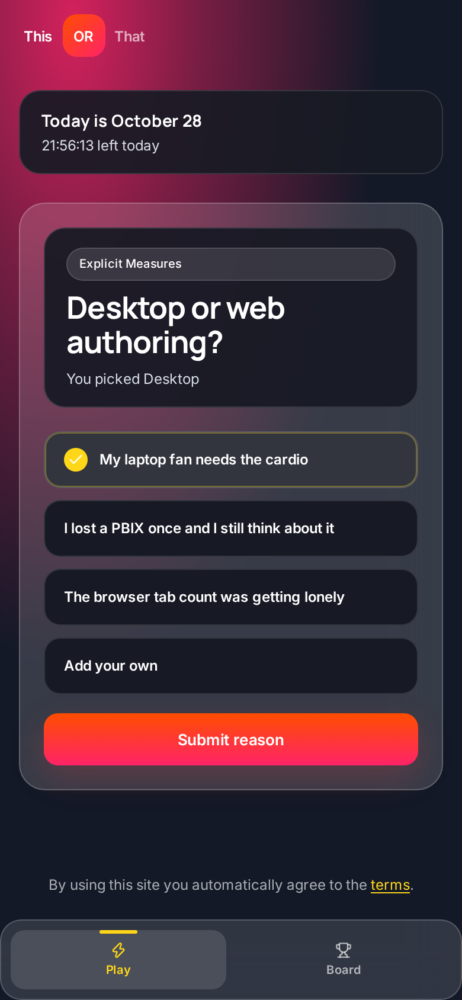
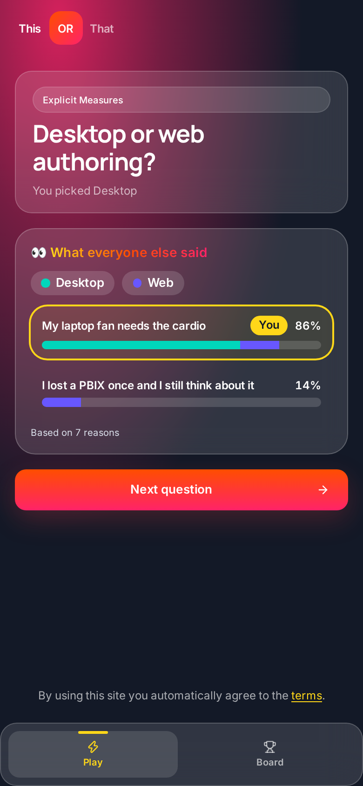
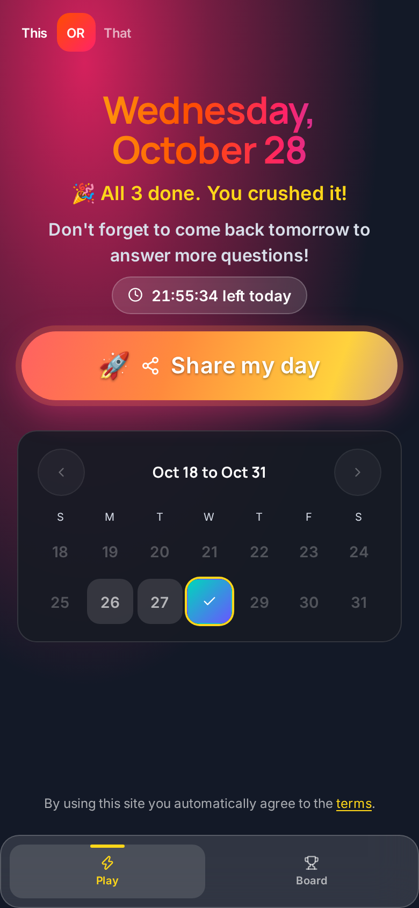
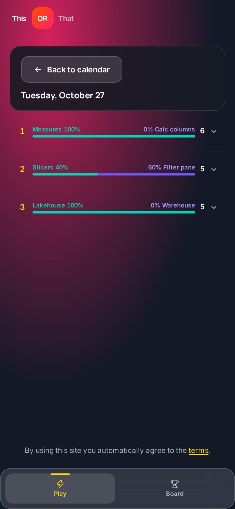
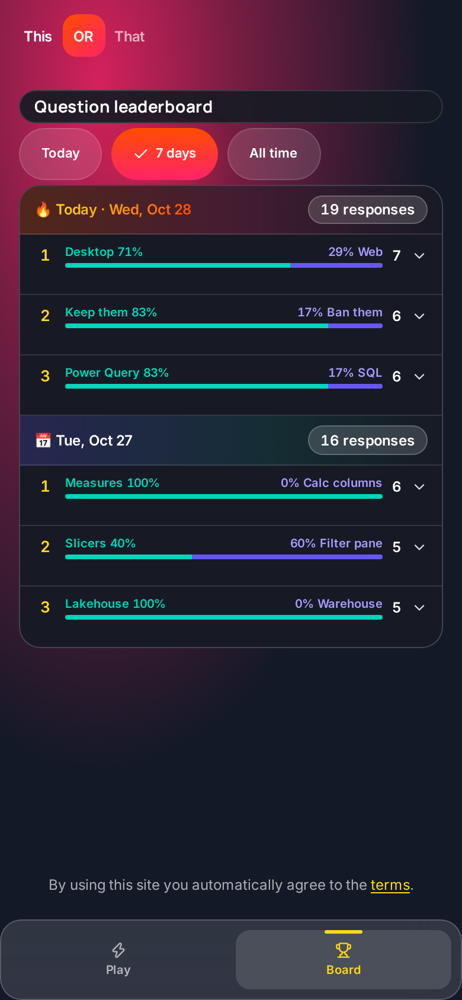
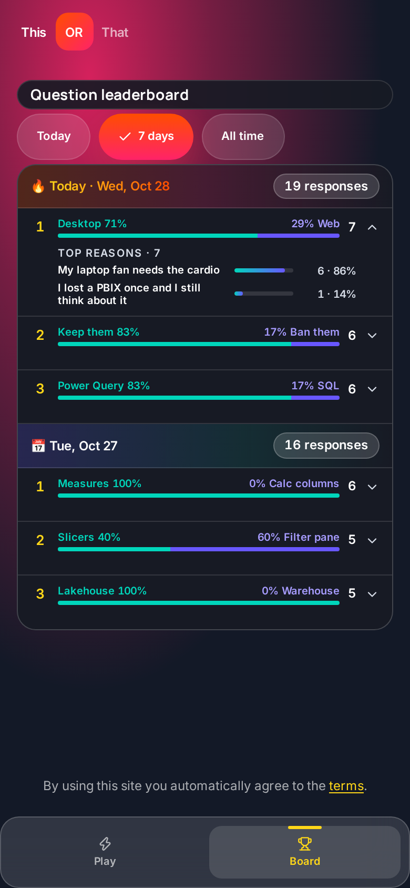

Import or DirectQuery? Measures or calculated columns? Keep pie charts or ban them forever? Every Power BI person has opinions. Now there is a place to put them.

**This or That** is a quick daily game from PowerBI.tips. Every day you get three Power BI hot takes, inspired by the debates we have on Explicit Measures. Pick a side, tell us why, and see how the rest of the community voted. It takes about a minute, and you will probably argue with your screen at least once.

Play it at [thisorthat.tips](https://thisorthat.tips/?utm_source=powerbi.tips&utm_medium=blog&utm_campaign=this_or_that&utm_content=how-to-play-this-or-that).

## What is This or That?

It is a "would you rather" for data people. Each question gives you two choices, A or B. There is no right answer (okay, sometimes there is, but we will let you decide).

- **3 questions a day**, the same three for everyone
- **No sign-up.** Just open the site and play
- **Works great on your phone** and on desktop
- **Community results** show you how everyone else picked and why

## How to Play

### Step 1: Open today's calendar

When you land on the site you see a big gradient header with today's date, how many questions are ready, and a countdown pill showing how much time is left in today's set. Below that is a two-week calendar with today highlighted.

Tap **Start** to begin.

### Step 2: Pick a side

Each question shows two big cards, A and B. Tap the one you agree with. Think fast, because once you pick, your answer is locked in.

### Step 3: Tell us why

Next, pick a reason. Each question comes with a few preset reasons, and fair warning, they are not serious. Want to make your own case? Tap **Add your own** and type it in. Then tap **Submit reason**.

### Step 4: See what everyone else said

After you submit, you get the **What everyone else said** screen. It shows how the votes split between the two sides and the top reasons from the community. Your reason is outlined with a **You** tag so you can see where you landed. If nobody has answered yet, you get the honor of going first.

Tap **Next question** to keep going.

### Step 5: Finish all three

Repeat for the next two questions. After the third one you are back on the calendar, today gets a check mark, and the header reminds you: *Don't forget to come back tomorrow to answer more questions!*

### Step 6: Share your day

Tap **Share my day** to brag a little. On a phone it opens your share sheet. On desktop you get quick options for X, LinkedIn, Facebook, or Copy link. The shared link even shows an animated preview of the This or That cards in apps that support it.

### Step 7: Look back at past days

Tap any past day on the calendar to see that day's questions, how the votes split, the top reasons, and your own pick if you played. Past days are read only, and future days stay locked so nobody peeks early.

### Step 8: Check the leaderboard

Tap **Board** in the bottom menu. The leaderboard groups questions by day, newest first. Each question shows an A vs B bar with percentages and the number of responses. Switch between **Today**, **7 days** and **All time**, and tap the arrow on any question to see its top reasons.

## Tips for Playing

- **Come back every day.** New questions drop at 7 PM Central. Make it part of your routine.
- **Share your results.** Send it to your team and find out who still loves pie charts.
- **Check the leaderboard.** Some splits are closer than you think.
- **Argue in the reasons.** The preset reasons are silly on purpose. If you have a better take, write your own and see if it makes the top list.

## FAQ

### Is This or That free?

Yes. It is free to play at thisorthat.tips.

### Do I need an account?

No. There is no sign-up. The game remembers your answers on your device with an anonymous ID, so use the same browser to keep your history.

### When do new questions drop?

Three new questions go live every day at 7 PM Central (midnight UTC). The countdown pill on the home screen shows how long is left in today's set.

### Can I change my answer?

No. Once you pick a side for a question it is locked in, so go with your gut.

### Is everyone answering the same questions?

Yes. Everyone gets the same three questions each day, which is what makes the community splits and reasons fun to compare.

### Can I play past days?

You can open any past day on the calendar to see the split, the top reasons and your own pick, but past days are read only. Future days stay locked.

## Built on Microsoft Fabric

Fun fact: This or That runs as an app on Microsoft Fabric. The votes and reasons live in the app's own database, and we use that data to power the community results and leaderboard. So yes, it is a Power BI game built on the same platform you use every day.

By using the site you agree to the terms linked in the footer. We use Microsoft Clarity analytics to see how people use the game so we can make it better.

## Play Today's 3

That's it. Three questions, about a minute, and a whole lot of opinions. Go see where you stand.

**[Play today's 3 at thisorthat.tips](https://thisorthat.tips/?utm_source=powerbi.tips&utm_medium=blog&utm_campaign=this_or_that&utm_content=how-to-play-this-or-that)**
